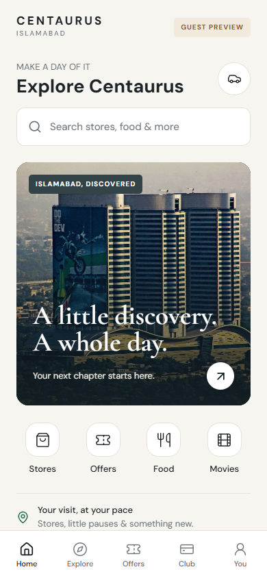
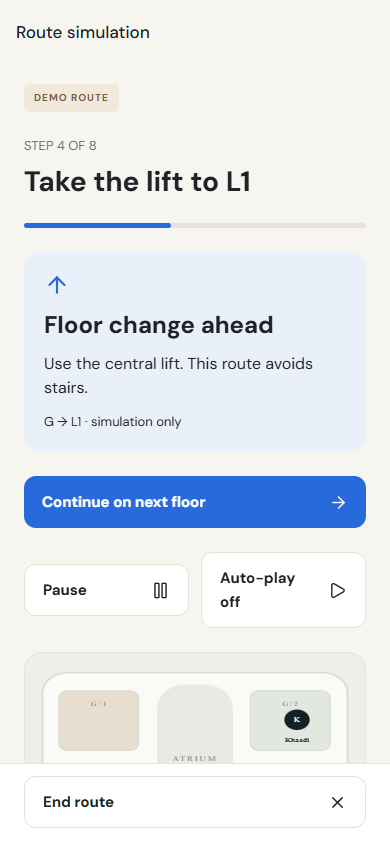
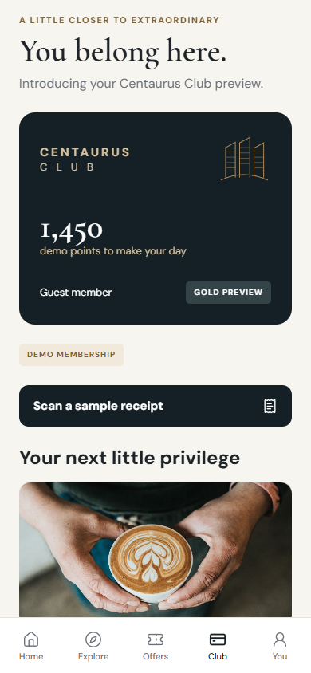

# Runtime screenshot gallery

These are actual Chromium captures of the Expo application, taken 9 October 2026. They are not generated mockups or native-device captures. Standard rehearsal: 390 × 844. Final narrow/offline/sheet checks: 360 × 800. Text stress capture: 130% browser font and line-height scaling; native Dynamic Type still needs device testing.

| Visitor discovery | Navigation | Local state |
| --- | --- | --- |
| [Home](screenshots/home-first.png) | [Selected-place sheet](screenshots/map-sheet.png) | [Drop](screenshots/drop.png) |
| [360px Home](screenshots/home-360.png) | [Lift floor transition](screenshots/route-floor-transition.png) | [Wallet](screenshots/wallet.png) |
| [Enlarged text](screenshots/home-large-text.png) | [Arrival](screenshots/route-arrival.png) | [Club](screenshots/club.png) |
| [Offline store detail](screenshots/offline-store.png) | [Reduced-motion route](screenshots/route-reduced-motion.png) | [Receipt credited](screenshots/receipt-awarded.png) |
| [Cinema selection](screenshots/cinema.png) | [Evening itinerary](screenshots/itinerary.png) | [Parking](screenshots/parking.png) |
| [Retailer editor](screenshots/retailer-editor.png) | [Parking arrival](screenshots/parking-arrival.png) | [Admin review](screenshots/admin-review.png) |

[Approved campaign in the consumer app](screenshots/approved-consumer-offer.png) · [Open visual gallery](gallery.html) · [Design audit](DESIGN_AUDIT.md)

Public competitor references are separate in [the research board](REFERENCES.md). Their screenshots are internal design-study evidence and are not part of the app runtime.
